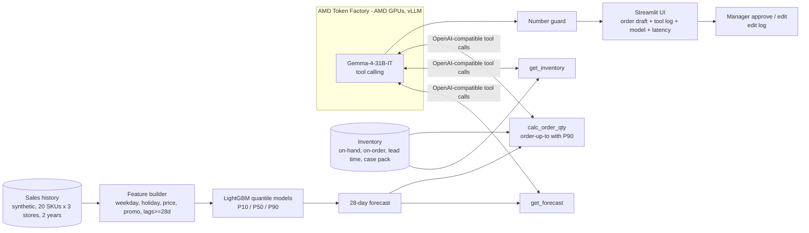

# 📦 StockSense — Demand Forecasting & Replenishment Agent on AMD

**lablab.ai AMD Developer Hackathon: ACT III · Track: Reinvent Commerce · Team: Takumu Hata (solo)**

StockSense helps small retailers order the right amount. A **LightGBM quantile model** forecasts daily demand per SKU × store with **P10/P50/P90** ranges, and an **LLM agent running on AMD GPUs via AMD Token Factory** turns those forecasts into explained purchase orders that a store manager approves or edits.

> **LLM inference runs on AMD GPUs via AMD Token Factory** (OpenAI-compatible API, vLLM on AMD Instinct). Default model: `Gemma-4-31B-IT`.

## Problem
Small and mid-sized retailers still order by gut feeling. They lose margin twice: **stockouts** (lost sales, unhappy customers) and **overstock** (waste, tied-up cash, markdowns). Enterprise forecasting suites are too expensive and too opaque for them.

## Solution
1. **Forecasting (numeric, not LLM-only)** — LightGBM quantile regression on sales history, weekday, holidays, price and promotion features → P10/P50/P90 per day, 28 days ahead.
2. **Replenishment agent** — an LLM on AMD Token Factory calls Python tools `get_forecast`, `get_inventory`, `calc_order_qty`. **All quantities are computed by tools** (order-up-to policy using P90 demand over lead time + 7-day review period, rounded to the case pack). The LLM only orchestrates and explains.
3. **Number guard** — every number in the LLM answer is checked against the tool outputs; unverified numbers are flagged in the UI.
4. **Human approval gate** — nothing is ordered automatically. The manager approves or edits each line; edits are logged for the session.
5. **What-if** — "What if we run a promotion next week?" re-forecasts with promo=1 and a discount and shows the change in demand and recommended order.

## Architecture


## AMD Token Factory usage
- The app uses the **openai Python SDK** with `base_url` pointed at AMD Token Factory: `OpenAI(base_url=AMD_TF_BASE_URL, api_key=AMD_TF_API_KEY)`.
- Model: `AMD_TF_MODEL` (default `Gemma-4-31B-IT`). If it is empty the app calls `GET /models` and prefers a Gemma model, otherwise the first one listed. No model name is hard-coded in the agent logic.
- Every agent response shows the **model name and latency** in the UI.
- Measured run (2026-10-18, store Tokyo-Shinjuku, 4 SKUs): `Gemma-4-31B-IT`, **12 tool calls**, 2 LLM calls (29.8 s + 4.3 s), total **34.2 s**, number guard **PASSED (21 numbers checked)**. Raw log: [`agent_run_sample.json`](agent_run_sample.json). In the recorded UI demo the same request took 64.3 s (LLM calls 48.1 s + 16.2 s); latency varies with Token Factory load.
- Keys are read only from environment variables or `st.secrets`. No key is stored in this repo.

## Results (backtest)
Holdout = last 28 days (2026-09-03 → 2026-09-30), 60 SKU × store series, forecasts made 1–28 days ahead (only lags ≥ 28 days are used, so there is no leakage).

| Model | WAPE % (lower is better) |
|---|---|
| **LightGBM P50 (StockSense)** | **35.0** |
| 28-day moving average | 40.8 |
| Same weekday last week | 51.1 |
| Same weekday last year | 52.0 |

- **14.2% lower WAPE than the best naive baseline** (28-day moving average).
- 75.4% of actual daily sales fall inside the P10–P90 band (nominal 80%).
- Reproduce: `python scripts/backtest.py`.

## Data — synthetic
**All data is synthetic**, generated by [`stocksense/data.py`](stocksense/data.py) (seed 42): 20 SKUs × 3 stores × 730 days, with weekday patterns per category, a simplified Japanese holiday calendar, yearly seasonality (e.g. ice cream / drinks in summer), trend, price changes with elasticity, promotion campaigns with discounts, and overdispersed (negative-binomial) noise. Inventory levels, lead times and case packs are also synthetic. No real store or customer data is used. Numbers above are measured on this synthetic data and are not a claim about any real retailer.

## Run locally
```bash
git clone https://github.com/taku629/stocksense-amd && cd stocksense-amd
pip install -r requirements.txt
cp .env.example .env   # put your AMD Token Factory key in .env (never commit it)
export $(grep -v '^#' .env | xargs)
streamlit run app.py
```
Without the AMD variables the app still runs (forecasts, backtest, order table, what-if); the agent button then explains that it needs the AMD key. No LLM output is ever faked.

Docker:
```bash
docker build -t stocksense .
docker run -p 8501:8501 --env-file .env stocksense
```

## Deploy on Streamlit Community Cloud
1. Fork / use this repo → https://share.streamlit.io → **New app** → repo `taku629/stocksense-amd`, branch `main`, file `app.py`.
2. **Advanced settings → Secrets**, paste:
   ```toml
   AMD_TF_BASE_URL = "https://developer.amd.com.cn/radeon/api/v1"
   AMD_TF_API_KEY = "your-amd-token-factory-key"
   AMD_TF_MODEL = "Gemma-4-31B-IT"
   ```
3. Deploy. First load trains the models (~10 s on CPU) and caches them.

## Demo assets
- Slides (PDF): [`submission/stocksense-slides.pdf`](submission/stocksense-slides.pdf) · Cover: [`submission/cover.png`](submission/cover.png) · App screenshots: [`submission/shots/`](submission/shots/)

## Repo layout
```
app.py                  Streamlit UI (forecast, backtest, AMD agent, approval, what-if)
stocksense/data.py      synthetic sales + inventory generator
stocksense/forecast.py  features, LightGBM quantile models, backtest, future forecast
stocksense/agent.py     tools, AMD Token Factory tool-calling loop, number guard
scripts/backtest.py     prints the WAPE table
scripts/agent_demo.py   runs the agent once from the command line
scripts/make_cover.py   cover image · scripts/make_slides.py  slides PDF
```

## Next
POS integration (real sales feeds), multi-store transfers before new orders, learning supplier lead-time distributions, spoilage-aware ordering for fresh goods.

## Technologies explained (short)
- **LightGBM** — fast gradient-boosted decision trees; strong on tabular data like sales with calendar/price features.
- **Quantile forecasting** — instead of one number, train models for the 10th, 50th and 90th percentile (pinball loss). P90 is used for ordering so we rarely run out.
- **WAPE** — Weighted Absolute Percentage Error = Σ|actual − forecast| / Σ actual. Robust to days with zero sales.
- **OpenAI-compatible API** — the same request format as OpenAI, so the standard `openai` SDK works by only changing `base_url`.
- **Tool-calling agent** — the LLM decides which Python function to call with which arguments; the code runs it and returns JSON. The LLM never invents quantities.
- **AMD Token Factory** — AMD's hosted inference service: open models (Gemma, Qwen, DeepSeek…) served with vLLM on AMD GPUs behind an OpenAI-compatible endpoint.

## License
MIT — see [LICENSE](LICENSE).
